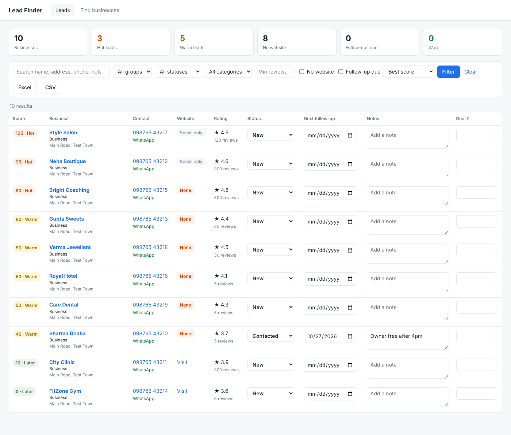
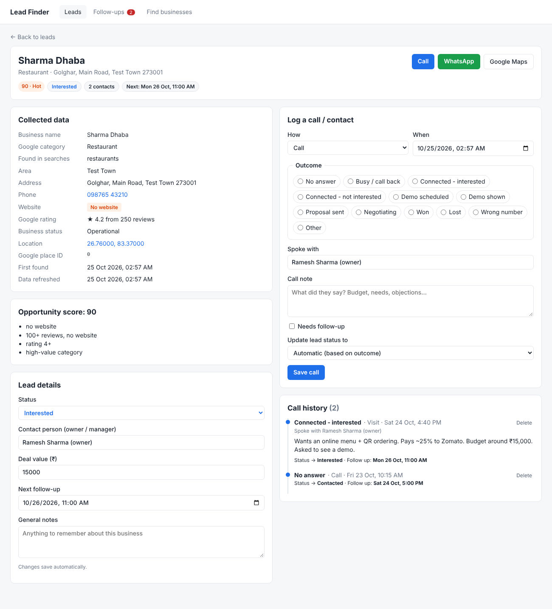
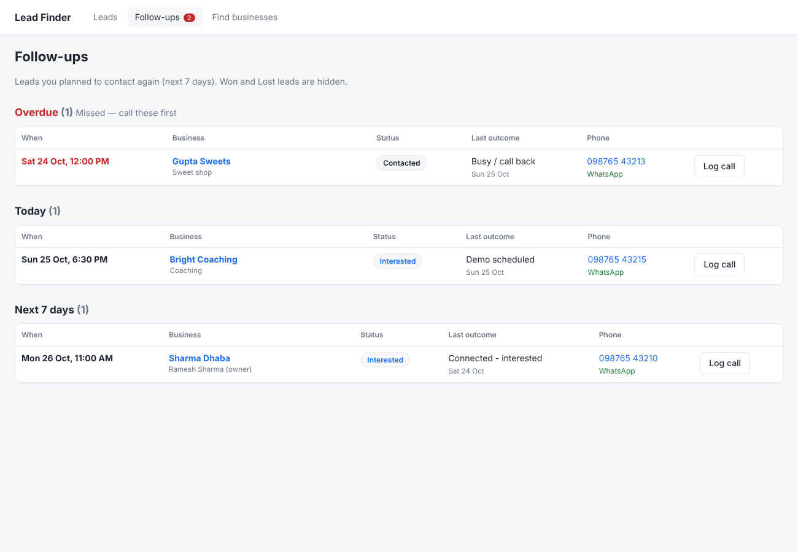

# Local Business Leads

Find local businesses (restaurants, clinics, clothing stores, gyms, ...) with the Google
Places API, score each one for "website / app opportunity", store them in a local MongoDB,
and track your pitching from a small web app.



**What you get**

- **Find businesses page** — pick an area, radius and categories, start a search, watch progress live.
- **Leads page** — every business with score (Hot / Warm / Later), phone, one-click WhatsApp,
  website status and rating. Filter by group, status, category, "no website", min reviews,
  or follow-ups due. Change status, follow-up date, notes and deal value inline (auto-saved).
- **Lead details page** — click any business name to see everything collected about it
  (address, phone, website, rating, location, score reasons, dates), with Call / WhatsApp /
  Maps buttons.
- **Call log (dispositions)** — every time you contact a lead, log how (call, WhatsApp, visit),
  the outcome, who you spoke with and a note. Tick **Needs follow-up** and pick the next call
  date and time. The lead's status, last contact and next follow-up update automatically, and
  the full call history is shown on the details page.
- **Follow-ups page** — leads to contact again, split into **Overdue**, **Today** and **Next 7
  days**, sorted by time. The red badge in the menu shows how many are due.
- **MongoDB storage** — re-running a search refreshes Google data but never overwrites your
  status, notes, call history or follow-ups.
- **Export** the current filtered list to Excel or CSV.

| Lead details + call log | Follow-ups |
| --- | --- |
|  |  |

## 1. Get a Google API key

1. Go to https://console.cloud.google.com/ and create a project.
2. Turn on billing for the project (Google gives a free monthly usage allowance; check current pricing).
3. Go to **APIs & Services → Library**, search **Places API (New)** and click **Enable**.
4. Go to **APIs & Services → Credentials → Create credentials → API key**.
5. Restrict the key to **Places API (New)** only.
6. Optional but recommended: set a budget alert in **Billing → Budgets & alerts**.

Never commit your API key to GitHub.

## 2. Start MongoDB locally

Pick one:

- **Docker (easiest):** `docker compose up -d` — starts MongoDB on `localhost:27017`, data is kept in a Docker volume.
- **Mac with Homebrew:**
  ```bash
  brew tap mongodb/brew
  brew install mongodb-community
  brew services start mongodb-community
  ```
- **Install directly:** [MongoDB Community Server](https://www.mongodb.com/try/download/community)
  (Windows/Mac/Linux). It runs on `localhost:27017` by default.

## 3. Install (with a virtual environment)

A virtual environment (`venv`) keeps this project's packages separate. You need it on a Mac,
where plain `pip` usually isn't available.

### Mac

1. Check you have Python 3.9 or newer:
   ```bash
   python3 --version
   ```
   If it's missing, install it with `xcode-select --install`, or with Homebrew: `brew install python`.

2. Create and turn on the virtual environment (run inside the project folder):
   ```bash
   cd local-business-lead
   python3 -m venv .venv
   source .venv/bin/activate
   ```
   Your terminal prompt now starts with `(.venv)`.

3. Install the packages:
   ```bash
   python -m pip install --upgrade pip
   python -m pip install -r requirements.txt
   ```

Every time you open a new terminal, turn the venv on again before running the app:

```bash
cd local-business-lead
source .venv/bin/activate
```

Type `deactivate` to turn it off.

### Windows

```powershell
python -m venv .venv
.venv\Scripts\activate
python -m pip install -r requirements.txt
```

### Linux

```bash
python3 -m venv .venv
source .venv/bin/activate
python -m pip install -r requirements.txt
```

If you see `pip: command not found`, use `python -m pip` (inside the venv) instead of `pip`.

## 4. Add your settings to `.env`

```bash
cp .env.example .env       # Windows: copy .env.example .env
```

Open `.env` and fill in at least:

```
GOOGLE_MAPS_API_KEY=your-key
LOCATION=Your City
LAT=26.76
LNG=83.37
RADIUS=8000
MONGO_URI=mongodb://localhost:27017
```

Find your area's latitude/longitude by right-clicking the spot on Google Maps.
`.env` is in `.gitignore`, so your key is never pushed to GitHub.

## 5. Run the web app

With the venv turned on (`source .venv/bin/activate`):

```bash
python app.py
```

Open http://127.0.0.1:5000

On a Mac, if port 5000 is busy ("Address already in use"), that's AirPlay Receiver. Either
set `PORT=5050` in `.env` and open http://127.0.0.1:5050, or turn off AirPlay Receiver in
**System Settings → General → AirDrop & Handoff**.

### Quick start on Mac (all commands)

```bash
git clone https://github.com/ashutoshofficial25/local-business-lead.git
cd local-business-lead
python3 -m venv .venv
source .venv/bin/activate
python -m pip install -r requirements.txt
cp .env.example .env              # then open .env and add your API key + location
brew services start mongodb-community   # or: docker compose up -d
python app.py
```

1. Go to **Find businesses**, check the area and categories, click **Start search**.
2. When it finishes, click **View leads**.
3. Work through Hot leads first: click a business (or **Log call**), call or WhatsApp them,
   then fill in **Log a call / contact**: outcome, note, and the next call time if they need a follow-up.
4. Each morning open **Follow-ups** and call the Overdue and Today lists.

### Call outcomes and what they do

| Outcome | Lead status becomes | Follow-up box ticked by default |
| --- | --- | --- |
| No answer | stays (New → Contacted) | yes, in 2 hours |
| Busy / call back | Contacted | yes, in 2 hours |
| Connected - interested | Interested | yes |
| Connected - not interested | Lost | no |
| Demo scheduled | Interested | yes |
| Demo shown | Demo shown | yes |
| Proposal sent / Negotiating | Interested | yes |
| Won | Won | no |
| Lost / Wrong number | Lost | no |
| Other | stays (New → Contacted) | no |

You can always choose a different status in **Update lead status to**.

## Command-line option (no web app)

The original script still works and saves Excel/CSV files:

```bash
python places_leads.py                       # uses .env settings
python places_leads.py --categories "restaurants,gyms" --grid 2
python places_leads.py --save-db             # also save the results into MongoDB
```

| Option | What it does |
| --- | --- |
| `--location` | Area name added to each search |
| `--lat`, `--lng` | Centre of your search area |
| `--radius` | Radius in metres (default 5000) |
| `--grid 3` | Splits the area into 3×3 smaller searches — finds many more businesses, but makes 9× the API calls |
| `--categories "restaurants,gyms"` | Only search these (default: 18 categories) |
| `--output my_leads` | Output file name |
| `--include-closed` | Keep closed businesses |
| `--save-db` | Save results to MongoDB too |

Google returns at most 60 results per search, so use a bigger grid for busy categories.

## Scoring

| Signal | Points |
| --- | --- |
| No website (or only Instagram/Facebook link) | +40 |
| 100+ reviews and no website | +30 |
| Only social media as website | +15 |
| Rating 4.0+ | +10 |
| High-value category (restaurant, clinic, hotel, gym, salon, coaching, school) | +10 |
| Under 10 reviews | −10 |

70+ = Hot, 40–69 = Warm, below 40 = Later. Hover the score badge in the app to see why.
Businesses that already have a website are flagged to check by hand — if it's old or
broken, they're a redesign lead.

## Project files

| File | Purpose |
| --- | --- |
| `app.py` | Flask web app (pages, API, export) |
| `db.py` | MongoDB storage (`leads`, `dispositions`, `searches` collections) |
| `places_leads.py` | Google Places search, scoring, Excel/CSV, CLI |
| `templates/`, `static/` | Frontend HTML and CSS |
| `docker-compose.yml` | Local MongoDB |
| `.env.example` | Settings template |

## Database collections

| Collection | One document per | Main fields |
| --- | --- | --- |
| `leads` | business | Google data (name, phone, website, rating, reviews, address, lat/lng), score, `lead_status`, `contact_person`, `notes`, `deal_value_inr`, `contact_count`, `last_outcome`, `last_contact_at`, `next_follow_up_at` |
| `dispositions` | contact attempt | `place_id`, `channel`, `outcome`, `note`, `contact_person`, `contacted_at`, `needs_follow_up`, `next_follow_up_at`, `status_after` |
| `searches` | search run | parameters, progress log, result counts |

Times like `contacted_at` and `next_follow_up_at` are stored as your local time
(`YYYY-MM-DDTHH:MM`).

## Cost tip

Each page of results is one billable request. 18 categories × 3 pages ≈ 54 requests per
run; grid 3 makes it ~9× more. The search page shows an estimate before you start.
Start small with a few categories to test.
